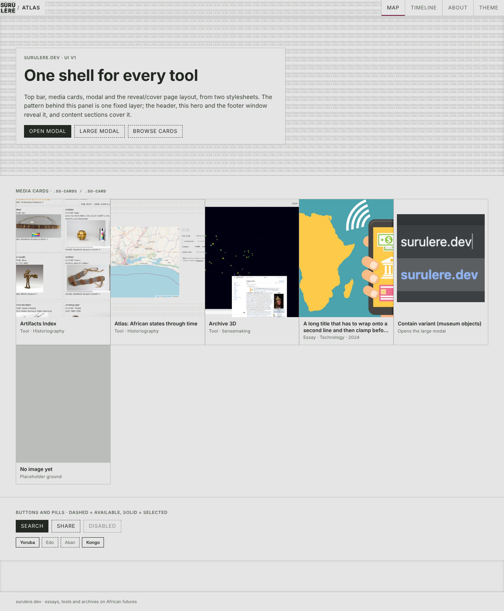
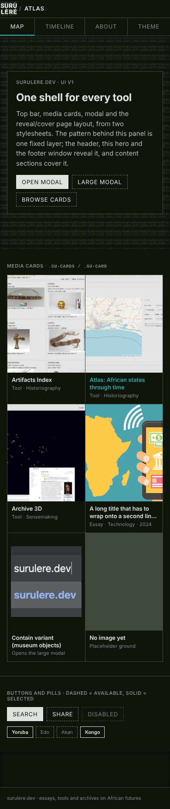
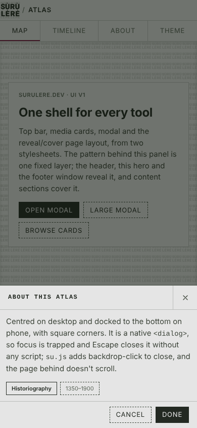
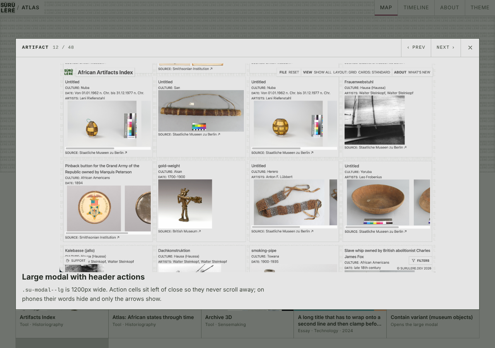
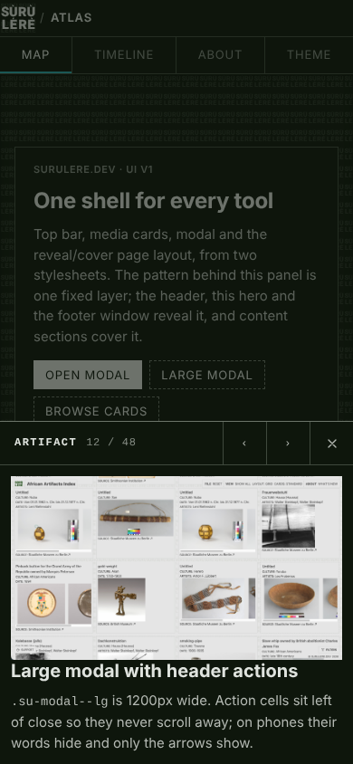
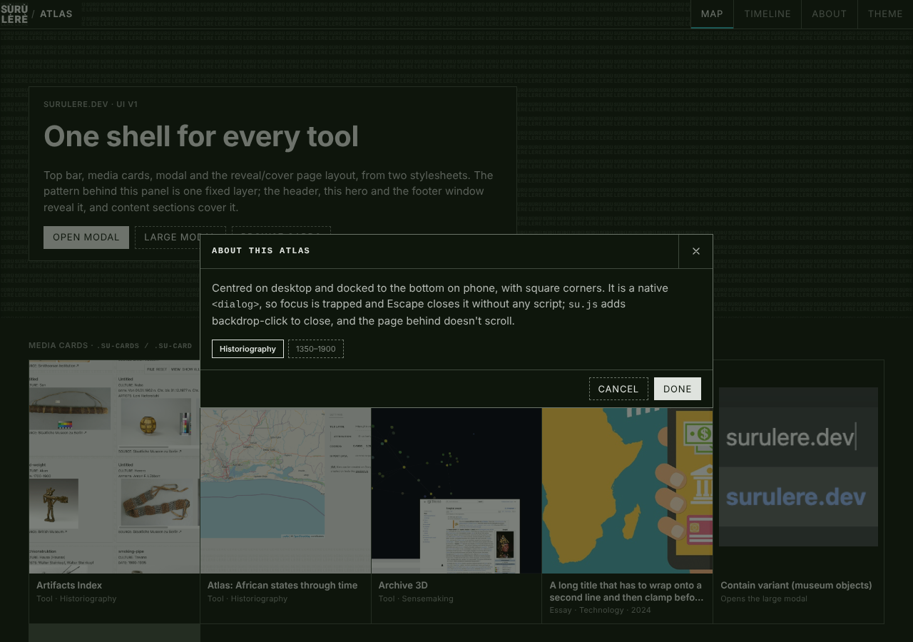
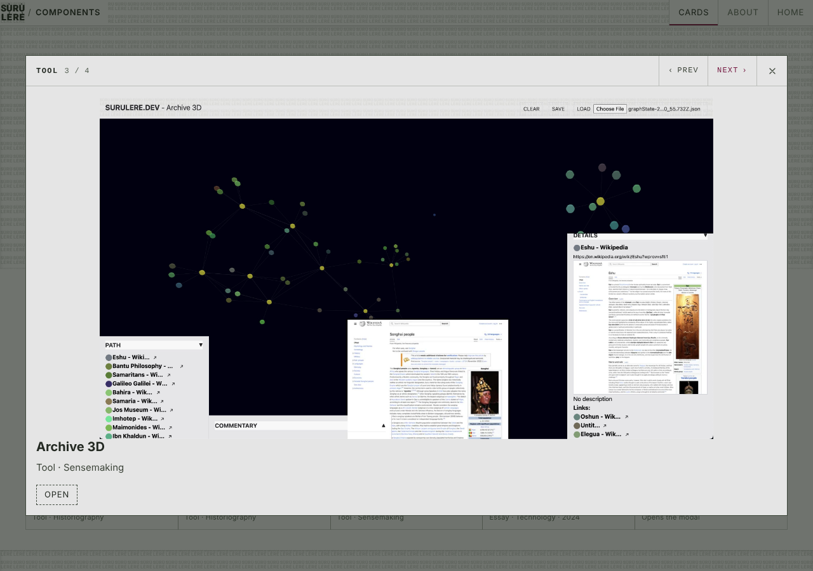

# Shared component library: proposal

Status: research plus a proof of concept, on branch `claude/shared-component-library`.
Builds on `docs/design-refresh-plan.md` (branch `claude/confident-franklin-n23gbv`) and `design-system.md` in african-artifacts.

**Recommendation in one line:** plain CSS (tokens plus `su-*` component classes) served as versioned static files from `surulere.dev/ui/v1/`, with thin React wrappers copied into each React repo. No web components and no npm package yet.

The proof of concept is in this branch:

| Path | What it is |
|---|---|
| `public/ui/v1/su-tokens.css` | Colour, type and geometry tokens; light/dark; works with the `.LIGHT`/`.DARK` classes every site already uses |
| `public/ui/v1/su-components.css` | Page ground and pattern, reveal/cover layout, top bar, media cards, modal, buttons, pills. Square corners throughout |
| `public/ui/v1/su.js` | Optional, 30 lines: `data-su-open` to open a modal, and backdrop click to close it |
| `public/ui/v1/su-mark.svg` | The SURU/LERE mark, used as a CSS mask for both the 40px logo and the 20px page pattern, in both themes |
| `public/ui/v1/demo.html` | One page with every component, plus live previews of itself at 390px and 1280px |
| `components/su/*.tsx` | React wrappers: `TopBar`, `MediaCard`/`MediaCards`, `Modal`, `Page`/`Window`/`Cover`/`Container`/`Panel`/`Footer`, `SuStyles` |
| `pages/ui-demo.tsx` | The same demo through the React wrappers (`/ui-demo/`, marked `noindex`, not linked) |
| `scripts/ui-visual-check.mjs` | Playwright check at phone and desktop widths in both themes (below) |

---

## 1. Audit

### What each site duplicates today

| | dotdev (surulere.dev) | african-artifacts (Artifacts Index) | archive-knowledge-base (Archive 3D) | atlas | akb `ui/` | symbolic-motif-analysis export |
|---|---|---|---|---|---|---|
| **Stack** | Next 12, Tachyons strings in `components/styles.ts` | React plus esbuild, Tailwind CDN | React plus Tailwind CDN | Hand-built HTML/CSS/JS | Hand-built HTML | Python writes one HTML file (`panel_art/site_template.py`) |
| **Tokens** | `styles/styles.css:1-37` | `public/styles/styles.css:1-50` | `public/styles/styles.css` (older fork of artifacts', 395 vs 659 lines) | `site/styles.css:18-78` (re-typed) | `ui/style.css:3-17`, its own indigo/slate palette | `site_template.py:81-160` (re-typed) |
| **Top bar** | None. A theme-swapped logo `` (`components/LayoutDefault.tsx:37-48`) | `layout.tsx` `#header`: 50px logo img, bordered title box, FILE/VIEW `#menu-bar` with a hamburger under 768px | `layout.tsx:138-` is a fork of the same header | `site/index.html:23-70`: `.brand` inline SVG at 38px, `.title-box`, `#menu-bar` re-written in plain CSS | `<h1>` in a sidebar | `site_template.py:605-630` copies atlas's `.brand`/`.title-box`/`.menu-bar` |
| **Modal / sheet** | None | `ModalLayout` in `layout.tsx:393-424` | `ModalLayout` in `layout.tsx:312-` (copy), plus a hand-rolled one in `components/CommentarySettingsPopup.tsx:24` | `#about .sheet` (`styles.css:477-504`) | None | Detail views inside the page |
| **Cards** | Tool rows with preview images (`pages/index.tsx:179-230`) | `components/MuseumObjectCard.tsx`: text first, images below, bordered | Panels, no cards | Side panels | `.result-card` (`style.css:64`) | `.card`, `.gallery-head`, `.grid-panels`, `.grid-motifs` (`site_template.py:336-445`) |
| **Footer** | `components/Footer.tsx`: fixed share/settings dropdowns, `.hide` hover tricks | `#copyright-footer` fixed bottom-right, plus floating CTAs | `#copyright-footer` (copy) | `.copyright` | None | Copyright row |
| **Pills / buttons** | `.tag` links | `.culture-pill*`, `.search-hero-button`, `.toolbar label` | `.toolbar` (copy) | `.menu-item[aria-pressed]`, `.tl-btn` | `.tab`, `#search-btn` (indigo fill) | `.menu-item` (copy) |
| **Pattern** | Body background, 50px, scrolls with the page; `body.animate-bg` | Same, 50px | Same, 50px | Data-URI texture, 50px | None | Data-URI texture, 50px |
| **Analytics** | Fathom/PostHog if env set | GA4 `G-M5R51L7ZVC` | GA4 `G-7R7YSBMT6W` | None | None | None |

In short, three families of copy-paste:
1. **The React shell** (`layout.tsx` with `Layout`, `ModalLayout` and `TabLayout`, plus `styles.css`) is forked between african-artifacts and archive-knowledge-base and has drifted.
2. **The hand-built shell** (`.brand`, `.title-box`, `.menu-bar`, `.menu-item`, texture data URI, tokens) is re-typed in atlas and the motif export.
3. **Tokens** are re-typed in five places, with three different dark-mode muted colours (`#535e52`, `#7d8a7b`, `#7d867b`).

### Where today's sites diverge from the agreed direction

- **Pattern:** every site uses a 50px tile that scrolls with the page. The direction is one 20px tile fixed to the viewport, revealed by windows and covered by content sections. (The refresh plan doc still says 50px. See the decisions list at the end.)
- **Top bar:** five different headers. None has the agreed shape (40px logo, `/ Tool name`, one segmented bar flush right). Artifacts and Archive 3D put the logo in a 50px box and the title in a bordered chip. dotdev has no bar at all.
- **Accent overuse:** artifacts links cultures in `text-blue-500` (`MuseumObjectCard.tsx`), which is off-palette. `design-system.md` lists the accent for "CTAs, active highlights, links", but the direction limits it to hover, focus and small current markers.
- **Dashed/solid inverted:** `MuseumObjectCard` is solid at rest and dashed on hover, which is the opposite of the rule.
- **Dark mode broken in modals:** both `ModalLayout`s hard-code `bg-white/80`, so the modal is a white box in dark mode.
- **Contrast:** dark `--txt-color-annotation: #535e52` is 2.7:1 and fails WCAG AA. Unselected pills at `opacity: 0.55` fail too.
- **Bugs found on the way:**
  - dotdev `styles/styles.css:22` sets `--title-color: #4D4D4;`, which is invalid (five digits), so the property is dropped.
  - artifacts `public/index.html:13` loads the stylesheet with `<script src="/styles/styles.css">`. It does nothing; the CSS only applies because `layout.tsx` imports it into the bundle.
- **Logo:** dotdev swaps between two image files per theme, and the light one is drawn in `#0A3D02` green rather than ink.
- **Off-brand:** akb `ui/` uses an indigo/slate palette, 6px radii and filled indigo buttons. The motif export brings in a serif stack (`--serif: "Iowan Old Style"…`) for readings.
- **Media card:** no site has the agreed card yet (image first, borderless title and meta bar, flush tiles with hairline gaps). I didn't find the parallel african-artifacts PR among the open PRs or the branch names, so `su-card` here is built from the brief. When that PR is up, its markup should be checked against the `su-card` structure below. Moving its CSS into the library afterwards is then a small change.

---

## 2. Architecture

### Options compared

| | **A. Plain CSS (`su-*`) + thin React wrappers** | **B. Web components** (`<su-topbar>`, `<su-card>`) | **C. React component package** |
|---|---|---|---|
| Hand-built HTML (atlas, akb, motif export) | Two `<link>`s. Nothing to build | One `<script>`; markup is custom tags | Doesn't serve them |
| Next.js (dotdev) | Wrappers render class names; SSR exact | Custom elements render empty on the server and upgrade on hydrate, so the top bar would jump on load | Works |
| esbuild React (artifacts, Archive 3D) | Same wrappers | Works, with React 18 attribute/event friction on custom elements | Works |
| Tailwind next to it | Fine: layout via Tailwind, look via `su-*` | Shadow DOM blocks Tailwind and site CSS from styling the inside | Fine |
| Theming | Custom properties; `.LIGHT`/`.DARK` keep working | Custom properties go through shadow DOM, so OK | Same as A |
| Source of truth | The CSS. Wrappers are about 40 lines each | JS template per component, plus React types | TSX; hand-built sites get nothing |
| Phone layouts | Media queries in one file | Same, inside each shadow root | Same as A |

**Delivery** is a separate choice from the component technology:

| | **npm package `@surulere/ui`** | **Versioned static files on surulere.dev** (`/ui/v1/`) |
|---|---|---|
| Hand-built pages | Need a CDN (unpkg) or a copy anyway | Link directly |
| Upgrades | Explicit: bump, lockfile, CI per repo | Automatic within a major version: one change reaches every site |
| Breakage risk | Contained to sites that upgrade | A bad change in `v1` ships everywhere at once |
| Overhead | Publish pipeline, npm org, version bumps in 4+ repos | None beyond dotdev's existing Pages deploy |
| Offline/self-contained (motif export) | Inline at build | Inline at build (fetch a pinned file) |

### Recommendation: A, delivered as static files

**Plain CSS tokens plus `su-*` classes, served from `https://surulere.dev/ui/v1/`, with thin React wrappers copied into `components/su/` in each React repo.**

- It's the only option that serves all six sites with one source of truth. Half the sites are hand-built HTML or generated HTML.
- It adopts **incrementally**. Nothing styles bare elements outside `.su-page`, so a site can link the CSS and switch one component at a time next to Tachyons or Tailwind.
- Assets already work this way: tools load `surulere.dev/assets/img/` today.
- The React wrappers carry no styling. A wrapper that drifts can only get markup wrong, and the visual check catches that.

**The main tradeoff** is runtime coupling. A change to `/ui/v1/` reaches every site without passing through that site's CI. The cost is that `v1` must be treated as an API:

- **Must:** within `v1`, changes are additive. New classes, new tokens and bug fixes are fine. Renaming or removing a class or token, or changing a component's box model, goes in `/ui/v2/`, and `v1` stays served.
- **Must:** dotdev CI runs `scripts/ui-visual-check.mjs` on any change under `public/ui/` and blocks the deploy on failure.
- **Might:** a site that wants to freeze can pin an immutable snapshot (`/ui/v1.3.0/`), copied by a release script when we tag.

Switch to an npm package when a third React app needs the wrappers, or when we want typed props across repos. The CSS stays the source either way; the package would just ship `components/su/` plus the same CSS.

Web components are a **might** for exactly one case: a `<su-topbar>` for hand-built pages that would otherwise copy the bar's markup. Even there, a markup snippet in the docs is simpler. I'd skip it until a fourth hand-built page appears.

### Theming

- Light is the base. Dark follows `prefers-color-scheme` unless the page forces a theme.
- Forcing accepts `.LIGHT`/`.DARK` (every current site) **or** `data-theme="light|dark"` (new pages), on any ancestor, so no site needs to change its toggle.
- Components use only `--su-*` tokens. The accent is reserved for `:hover`, `:focus-visible` and the 2px current marker; nothing is filled with it.
- The pattern and logo are **masks** over one SVG (`su-mark.svg`), coloured by `--su-pattern` and `currentColor`. That's one asset for both themes, no per-theme image swap, and the logo follows hover colour for free.
- The dark values are written twice, once for the media query and once for forced dark, because CSS can't share a block between the two. The visual check fails if they drift.

### How each site consumes it

| Site | Install | Notes |
|---|---|---|
| dotdev | `<SuStyles base={process.env.NEXT_PUBLIC_BASE_PATH \|\| ""} />` in `_document`, same origin, so PR previews test their own copy | Wrappers live here first |
| african-artifacts, Archive 3D | Two `<link>`s in `index.html` (replacing the broken `<script>` tag), copy `components/su/` | Tailwind stays for layout; colours and borders move to tokens |
| atlas, akb `ui/` | Two `<link>`s, plus `su.js` with `defer` if using modals | Delete re-typed tokens and chrome |
| motif export | `export_interpretation_site.py` fetches a pinned version (`/ui/v1.x.y/`) at build and inlines it | The page has to stay one offline file |

**Musts for hosting:**
- The pattern and logo are CSS masks, which browsers fetch with CORS. GitHub Pages sends `Access-Control-Allow-Origin: *`, so this works today. Any future host or CDN must keep that header.
- `su-mark.svg` is referenced relative to the stylesheet. Keep the two files in the same directory.

### Versioning and cache safety

- GitHub Pages serves everything with `Cache-Control: max-age=600`, and we can't change headers there. A `v1` fix reaches everyone within about 10 minutes, and a bad fix is reverted just as fast.
- That's acceptable while the change rules above hold.
- **Might:** if we want long-lived caching, add `?v=<hash>` to the links in the React apps at build time, or put Cloudflare in front and mark `/ui/v*.*.*/` immutable.
- **Never** edit a pinned `vX.Y.Z` directory after it ships.

### Testing

`node scripts/ui-visual-check.mjs <outDir>` serves `public/`, opens `ui/v1/demo.html` at **390px and 1280px** in **light and dark**, and:

- fails on any sideways scroll, the most common phone-width breakage;
- fails if the segmented bar doesn't hug the right edge, if the top bar isn't one 40px row on desktop, or if it doesn't wrap to two rows on phone;
- fails if forced-theme tokens differ from OS-theme tokens;
- opens both modals (720px and 1200px) and checks each docks to the bottom on phone and is centred on desktop, has square corners, locks the page scroll, shows icon-only action cells on phone and labelled ones on desktop, and closes on Escape;
- fails if buttons have rounded corners;
- writes eight screenshots for review.

It asserts layout facts, not pixels, so it doesn't flake on font rendering across machines.

- **Must:** run it in dotdev CI for `public/ui/**` changes, uploading the screenshots as a build artifact.
- **Might:**
  - pixel baselines (`toHaveScreenshot`) once the look settles;
  - the same script pointed at each site's own page in that site's CI;
  - an axe-core pass for contrast and labels.

---

## 3. Proof of concept

### Components

| Component | Classes | React | Phone behaviour |
|---|---|---|---|
| Page ground + pattern | `.su-page` | `<Page>` | One fixed 20px pattern layer (a `position: fixed` pseudo-element, because iOS Safari ignores `background-attachment: fixed`) |
| Reveal / cover | `.su-window` (`--hero`, `--footer`), `.su-cover`, `.su-panel`, `.su-container`, `.su-footer` | `<Window>`, `<Cover>`, `<Panel>`, `<Container>`, `<Footer>` | Gutter is 16px under 600px, 24px to 1024px, 40px above |
| Top bar | `.su-topbar`, `__logo`, `__site`, `.su-seg`, `.su-seg__cell` | `<TopBar site items>` | The segmented bar drops to its own full-width row; cells share it and scroll if there are many. Cells grow to 44px on touch screens |
| Media card | `.su-cards`, `.su-card` (`--contain`, `--square`, `--wide`), `__media`, `__bar`, `__title`, `__meta` | `<MediaCards>`, `<MediaCard>` | Two columns at 390px (min 150px), auto-fill above |
| Modal | `dialog.su-modal` (`--lg`), `__head`, `__title`, `__count`, `__cell`, `__cell-text`, `__close`, `__body`, `__foot` | `<Modal open onClose title actions size scrollKey labelledBy footer>` | Centred on desktop (720px, or 1200px for `lg`); full width and docked to the bottom at 92dvh on phone, safe-area padded. Action cells show only their icons |
| Buttons, pills | `.su-btn` (`--primary`), `.su-pill` + `aria-pressed`, `.su-pills`, `.su-label` | Plain classes | 44px targets on coarse pointers |

### Design details worth knowing

- **The sticky top bar** can't be a see-through window, because content scrolls under it. It carries its own copy of the pattern over solid ground. That copy is also fixed to the viewport and clipped to the bar, so its tiles line up exactly with the page's.
- **Flush cards with hairlines:** each card draws a 1px ring with `box-shadow` and the grid gap is 1px, so rings meet. A coloured grid background would leave stray lines in a part-filled last row; this doesn't.
- **The modal is a native `<dialog>`.** Focus trap, Escape, top layer and `inert` background come from the browser. React only mirrors `open`. Plain pages get backdrop-click from `su.js`. `html:has(.su-modal[open])` locks the page scroll behind it.
- **The modal header is a bar of cells**, like the top bar: title (with an optional `__count` such as "12 / 48"), then `actions` cells such as ‹ PREV / NEXT ›, then close. The cells sit in the header, so they never scroll away. `scrollKey` returns the body to the top when its content changes.
- **Same API in both repos.** `components/su/Modal.tsx` matches `Modal` in african-artifacts PR #85 (props `open`, `onClose`, `title`, `children`, `footer`, `actions`, `size`, `closeLabel`, `labelledBy`, `scrollKey`, and the same `su-modal*` classes). It's the first component in use outside this repo; when that PR merges, its CSS can move to `/ui/v1/` and the two files stay identical.
- **Square corners everywhere:** `--su-radius` is 0, and modals, buttons and pills have no rounding, including the modal's top edge on phones. `design-system.md` still says 4px and should be updated with the next library PR there.
- **State follows ARIA attributes:** `aria-current` and `aria-pressed` drive the selected styles, not extra classes, so a correctly labelled control is also correctly styled.

### Values I picked that need a yes

These go beyond the plan doc; all are one-line token changes.

- Light `--su-text: #3c4439`. It's darker than today's `#4d4d4d` and sits between the ink and the muted colour.
- Light `--su-muted: #5a6458`.
- Dark `--su-ink: #dfe3de` for headings and `--su-text: #b4b9b3` for body. Today's single dark text colour, `#a3a8a2`, is replaced by this pair, so headings separate from body copy.
- Dark `--su-muted: #848b83`, per the plan.
- `--su-line-strong` for dashed and solid control borders. It's 3:1 or better on the ground, as WCAG asks for UI boundaries. The faint `#3f493d2e` stays for hairlines only.

### Run it

```
npx serve public    # or any static server, then open /ui/v1/demo.html
npm run ui:check    # writes screenshots to ui-screens/ (git-ignored)
npm run dev         # React version at /ui-demo/
```

Both pass today: the visual check is green at both widths and in both themes. The React demo renders the same markup with no console errors and no sideways scroll, its modals open and close by Escape and backdrop click, and prev/next steps through the large one. The wrappers type-check under `--strict`.

Screenshots from this run are in `docs/ui-screens/`:

| | |
|---|---|
|  |  |
|  |  |
|  |  |
|  | |

---

## 4. Migration order

**Consistency first, then components.** Every PR below is small (roughly under 300 changed lines) and can ship on its own.

| # | Repo | PR | Musts | Size |
|---|---|---|---|---|
| 1 | dotdev | Land `public/ui/v1/`, `components/su/`, the visual check and a CI job for `public/ui/**` (this branch) | Yes | S |
| 2 | african-artifacts | Link `su-tokens.css` and `su-components.css` (fix the `<script>` tag). Point old variables at new tokens (`--bg-color: var(--su-ground)` …) so the whole app picks up the corrected palette and contrast at once | Yes | S |
| 3 | african-artifacts | The media-card PR uses `su-card` markup. Its CSS moves to the library, and `MuseumObjectCard` keeps only data and `ImageWithPlaceholder` | Yes | S, coordinated with the parallel PR |
| 4 | african-artifacts | `ModalLayout` becomes `<Modal>`, which fixes the white modal in dark mode. **In progress:** PR #85 | Yes | S |
| 5 | atlas | Swap re-typed tokens and texture for `su-tokens.css`. Header becomes `su-topbar`. `#about` becomes `su-modal` | Yes | S |
| 6 | dotdev | Homepage on the shell: `LayoutDefault` uses `<Page>`/`<TopBar>`; hero `<Window>`; tools as `<MediaCards>`; `<Footer>`. Remove `components/styles.ts`. Check Notion pages on `<Cover>` | Yes | M, split across two PRs: shell, then sections |
| 7 | african-artifacts | Header becomes `<TopBar site="Artifacts Index">`; FILE/VIEW become segmented cells; restyle `SearchHero` buttons and culture pills to `su-btn`/`su-pill` | Yes | M |
| 8 | symbolic-motif-analysis | `export_interpretation_site.py` inlines a pinned `/ui/v1.x.y/`; template chrome becomes `su-topbar`/`su-card` | Yes | S–M |
| 9 | archive-knowledge-base | Tokens, top bar, `ModalLayout` and `CommentarySettingsPopup` become `<Modal>` (copied from african-artifacts). Graph keeps its dark stage | Yes | M |
| 10 | akb | Re-token from indigo, top bar, `.result-card` becomes `.su-card`/rows | Yes, but last: lowest traffic, biggest visual change | M |
| – | all | Share `su-analytics.js` and `data-track` (from the plan) | Might, but cheap once the bars are shared | S |

The order puts the parallel card PR and the dark-mode modal bug early, which are where the most visible wins are. Atlas comes next because it's already closest and proves the hand-built path. The dotdev homepage follows once the components have been used in anger in two places.

---

## Musts and mights

**Musts (non-negotiable)**
- One source of truth for tokens; no site re-types hex values.
- System fonts only; the accent only for hover, focus and current markers; dashed means available, solid means selected.
- One fixed page pattern at one tile size, revealed by windows and covered by content.
- The same top bar shape on every site.
- Works at 390px with no sideways scroll and 44px touch targets; modals dock to the bottom on phone.
- Dark mode passes WCAG AA for text (≥4.5:1) and UI borders (≥3:1).
- `v1` is additive only; breaking changes go in `v2`.
- The visual check gates changes to `public/ui/`.
- CORS header stays on whatever serves `/ui/`.

**Mights (nice to have)**
- Immutable `vX.Y.Z` snapshots and a release script.
- Pixel-baseline screenshots and axe checks.
- `<su-topbar>` web component.
- `@surulere/ui` on npm once a third React app needs it.
- Logo-window slide and hero slide motion (`bg-slide` moved onto the 40px logo cell).
- A `su-compat.css` that maps every old variable name, for sites that can't touch their CSS yet.
- Modal open and close transitions with `@starting-style`.

---

## Summary

**Recommend:** one plain-CSS library (`su-tokens.css` plus `su-components.css`) served from `surulere.dev/ui/v1/`, with thin React wrappers copied into each React repo. It serves Next, esbuild and hand-built HTML from one file, adopts one component at a time, and needs no build or publish step. The cost is that `v1` changes reach every site at once. That's made safe by an additive-only rule within `v1` and a Playwright check at 390px and 1280px in both themes. The proof of concept (tokens, top bar, media card, modal, reveal/cover layout, demo page and React demo) is in this branch.

**Need decided:**
1. **Pattern tile size:** 20px (the brief, half the logo; used in the PoC) or 50px (the plan doc and every site today)?
2. **Default theme:** follow the OS (the PoC default) or force one?
3. **Hosting:** GitHub Pages with 10-minute caching and no custom headers is fine for now. OK, or put a CDN in front?
4. **Token values** listed under "Values I picked": approve or adjust.
5. **Motif export serif** for long readings: keep as a scoped exception, or go system sans?
6. **The parallel media-card PR** in african-artifacts: share the link or branch so its markup can be lined up with `su-card` before either merges.
